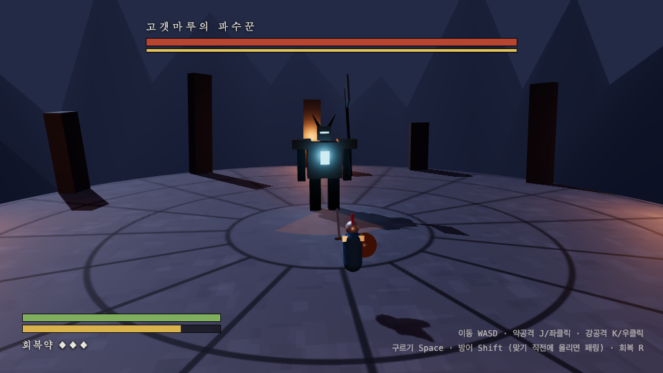

# Shield and Blade

브라우저에서 바로 하는 1대1 보스 결투 게임. 달빛 아래 고갯마루의 돌 원형 마당에서, 방패와 검으로 **고갯마루의 파수꾼**을 쓰러뜨린다.

소울라이크 장르의 문법(스태미나 관리, 예비동작을 읽고 피하기, 체간 붕괴, 2페이즈)을 따르되, 핵심은 **방패 패링**이다. 공격이 닿기 직전(0.15초 안)에 방패를 올리면 피해 없이 튕겨내고 파수꾼의 체간을 크게 깎는다.

이름·캐릭터·배경·형상은 모두 독자 제작이고, 그림·소리 파일 없이 전부 코드로 그린다(Three.js, 빌드 단계 없음).



## 실행

```
npm install
npm start        # http://127.0.0.1:5173/
```

## 조작

| 행동 | 키보드·마우스 | 게임패드 |
|------|---------------|----------|
| 이동 (보스를 바라보는 방향 기준) | W A S D / 방향키 | 왼쪽 스틱 |
| 약공격 (3연타) | J / 좌클릭 | RB |
| 강공격 | K / 우클릭 | RT |
| 구르기 (무적 0.32초) | Space | B |
| 방어 / 패링 | Shift 또는 L (맞기 직전에 올리면 패링) | LB |
| 회복약 (3개) | R 또는 E | X |
| 시작 / 재도전 | Enter / 클릭 | Start / A |

읽는 법: 바닥의 붉은 영역이 공격 범위, 보라색은 방어 불가. 파수꾼의 날이 금빛으로 번쩍이면 패링할 수 있는 공격이 곧 닿는다. 원형 내려찍기는 패링할 수 없으니 구른다.

## 구조

```
입력(src/input.js) → 시뮬레이션(src/sim/, 1/60초 고정 스텝, DOM·three 없음) → 화면(src/view.js) + HUD(src/hud.js)
```

- `src/sim/rules.js` — 모든 수치와 보스 기술 표
- `src/sim/sim.js` — 결투 규칙. 같은 시드와 같은 입력은 같은 결과를 낸다
- `src/sim/bot.js` — 입력만 내는 자동 조종 (`?auto=skilled|masher|idle`, `?speed=20`, `?seed=1`)

## 검사

```
npm test                    # 전투 규칙 단위 테스트
npm run check:smoke         # 실제 페이지가 오류 없이 그려지고 키 입력이 동작하는지
npm run check:playthrough   # 승리·사망·재도전까지 한 판이 끝까지 진행되는지
npm run check:original      # 참고 대상의 이름과 외부 에셋 파일이 없는지
```

브라우저 검사는 설치된 Google Chrome을 헤드리스로 띄운다.
